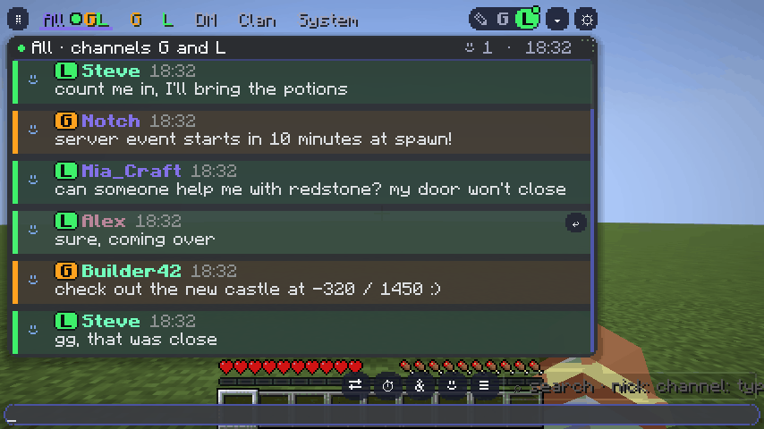

<p align="center"></p>

<h1 align="center">Aurora Chat</h1>

<p align="center">A beautiful, smooth and highly customizable chat for Minecraft (Fabric, client-side).<br>
Красивый, плавный и настраиваемый чат для Minecraft (Fabric, только клиент).</p>

<p align="center">
  <a href="https://binoplw.github.io/aurora-chat/">Website / Сайт</a> ·
  <a href="https://modrinth.com/mod/aurora-ryizen">Modrinth</a> ·
  <a href="../../issues">Bug reports / Баги</a> ·
  <a href="CHANGELOG.md">Changelog</a>
</p>

<p align="center"><a href="https://github.com/binoplw/aurora-chat/actions/workflows/build.yml"></a></p>

<p align="center"></p>

---

## Features

- **Window** — move it by ⠿ and resize like a messenger; Compact / Discord-like / Messenger layouts
- **30+ themes** — Discord, Telegram, WhatsApp, iMessage, Twitch, Steam, Spotify and more; share your theme as a code
- **Channels & tabs** — global / local chat (G / L) with badges; tabs All, G, L, DM, Clan, System and your own; extra windows
- **Translator** — right-click a message → Translate; the ⇄ button translates what you type
- **Convenience** — right-click menu (copy with colors, reply, mention, pin), smart search (`nick:` `channel:` `type:` `date:`), history across restarts, `&` color palette with gradients, emoji, Tab name completion, scheduled messages, reminders, AFK auto-reply, anti-spam, word filter
- **Performance** — about 1 ms per frame with a 2000-message history, low-FPS saving mode
- **Languages** — English and Russian (follows the game language)

## Возможности

- **Окно** — двигается за ⠿ и растягивается; раскладки: компактная, как в Discord, мессенджер
- **30+ тем** — Discord, Telegram, WhatsApp, iMessage, Twitch, Steam, Spotify и другие; обмен темами кодом
- **Каналы и вкладки** — G / L со значками, вкладки Все, G, L, ЛС, Клан, Система и свои, отдельные окна
- **Переводчик** — ПКМ по сообщению → «Перевести», кнопка ⇄ переводит то, что пишешь
- **Удобство** — меню по ПКМ, умный поиск, история между запусками, палитра «&» с градиентами, эмодзи, ники по Tab, отложенные сообщения, напоминания, АФК-автоответчик, антиспам, фильтр слов
- **Не лагает** — около 1 мс на кадр при истории в 2000 сообщений

## Requirements

Minecraft **26.1.2**, Fabric Loader, **Fabric API**. [Mod Menu](https://modrinth.com/mod/modmenu) is optional.
Settings: `/achat` or ⚙ in the chat header.

## Building

Java 25 is required.

```
gradlew build                 # build/libs/aurora-chat-<version>-public.jar
gradlew runClientGameTest     # in-game tests (opens a test world, takes screenshots)
```

`libs/` contains a prebuilt [Aurora Lib](libs) (performance helpers shared by Aurora mods); it is bundled into the mod jar.

### Translations

UI texts are written in Russian in the code and translated at display time using
`src/main/resources/assets/aurorachat/i18n/en.json` (key — Russian text, value — translation).
To add strings: `python i18n/extract_ui.py src/main/java/net/primlixe/aurorachat i18n/ui_ru.txt`, add lines
`number<TAB>translation` to `i18n/en_N.txt`, then `python i18n/build_dict.py src/main/resources/assets/aurorachat/i18n/en.json`.
Pull requests with new languages are welcome.

## License

[MIT](LICENSE)
